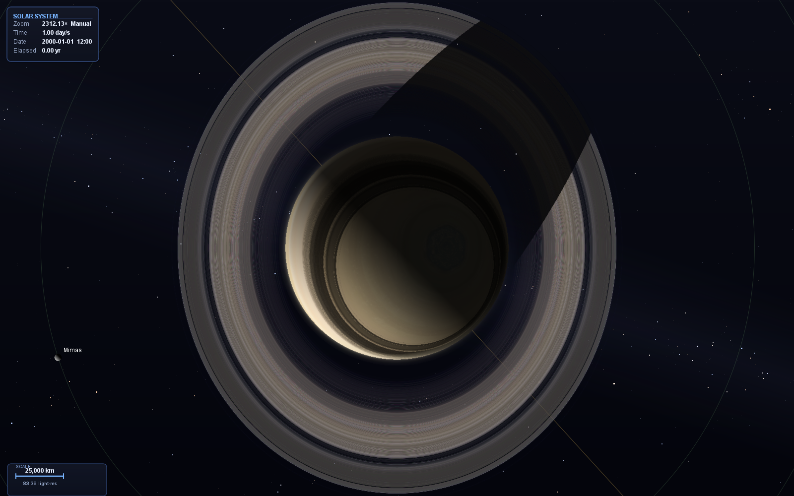
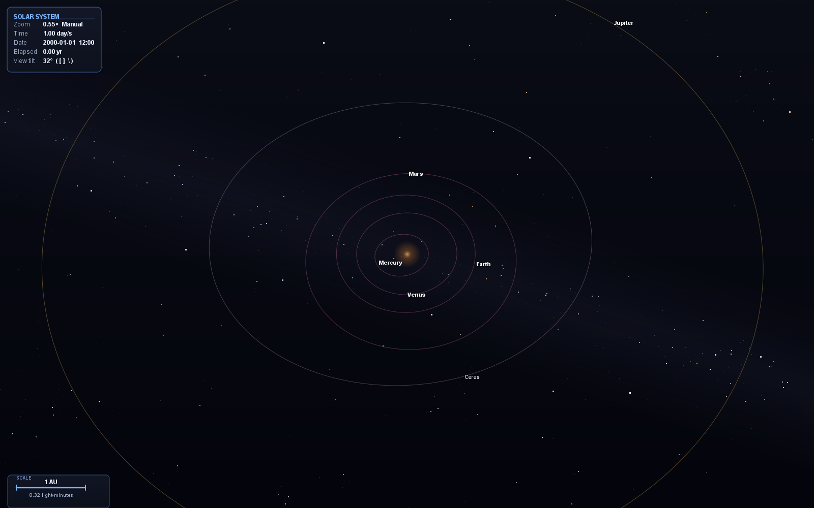
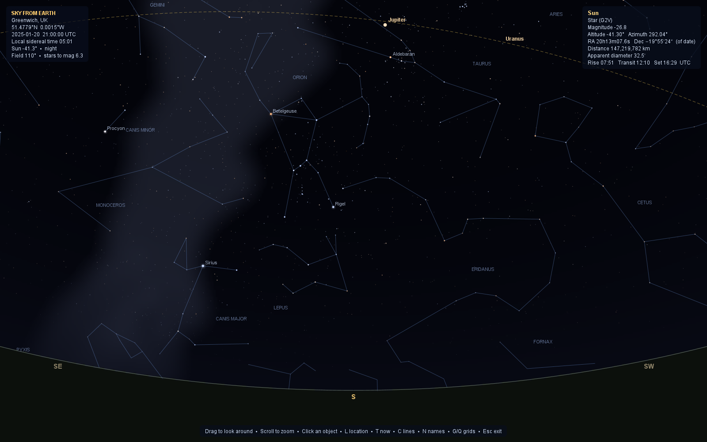
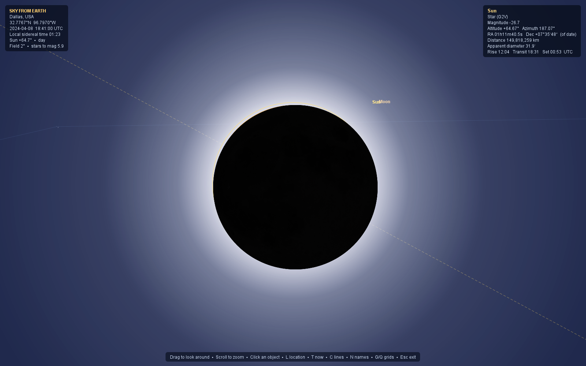

# Astronomy Suite

An interactive Java solar-system simulator with a built-in **Lesson Studio** of
hands-on, animated 3-D astronomy lessons.







The app is a Swing program with a GPU sphere shader (`GLSphereRenderer`) for
textured planets. The planets, dwarf planets, comets and asteroids move under their
**mutual gravity**, integrated by a symplectic Wisdom–Holman map from JPL Horizons
initial conditions; every moon is on its real orbit; and the whole scene sits in front
of the **real star field** (Yale Bright Star Catalogue + Milky Way). It hosts the
**Lesson Studio**, a real-date **planetarium**, a **Sky from Earth** view of the sky
from any place on Earth, and a catalog of real comets and minor bodies. The 3-D view
tilts off top-down to reveal orbital inclination and out-of-plane motion.

## Requirements

- **JDK 24** (the sim uses unnamed `_ ->` variables and other Java 22+ features).
- **JOGL 2.6** + **GlueGen 2.6** natives. These are **not** on Maven Central and
  are **not** committed here — download a build from the
  [JogAmp archive](https://jogamp.org/deployment/archive/master/). By default the
  build looks for them in the sibling folders the run script uses (one directory
  *above* the project root); override with `-PjoglDir=…` / `-PgluegenDir=…`.
- FlatLaf is fetched automatically (from Maven Central) by the Gradle build; a
  bundled copy is also in `libs/` for the PowerShell script.

## Running

### Gradle (cross-platform, recommended)

The wrapper needs no local Gradle install and auto-provisions a matching JDK:

```bash
./gradlew run                 # build + run (GUI)
./gradlew run -Pgpu           # GPU sphere shader on from the start
./gradlew run -Pshot=out/dir  # render the head-less showcase PNGs, then exit
./gradlew run -Ppitch=30      # start with the view tilted 30 deg off top-down
./gradlew run -Pyaw=45        # start rotated 45 deg in azimuth
```

If the JOGL jars aren't in the default location, point the build at them:

```bash
./gradlew run -PjoglDir=/path/to/jogl/jar -PgluegenDir=/path/to/gluegen/jar
```

### PowerShell (Windows)

```powershell
./run2d.ps1              # build + run (GUI)
./run2d.ps1 -Gpu         # GPU sphere shader on from the start
./run2d.ps1 -Shot out\shots   # head-less showcase screenshots
```

## Lesson Studio

Open **Education → Lessons...** (or pick a lesson directly from the Education menu).
Lessons run on the live simulation. A lesson panel docks on the right, and each
step reconfigures the real solar system to demonstrate its idea: it shows only the
bodies it needs, sets the clock (and sometimes the date), flies the camera there,
and draws its explanations straight into the 3-D scene. The eccentricity lesson
follows the real Mercury through perihelion and aphelion; the flux lesson hides
every planet and wraps the real Sun in a Gaussian bubble, then flies in close to
its textured surface. You keep the normal camera controls (drag, scroll;
double-click returns to the step's view). The panel holds the narration, sliders
and "check yourself" questions. **Esc** or **← Lessons** restores the simulation
exactly as you left it: visibility, date, time speed and camera.

| Level | Lesson | What you do |
| ----- | ------ | ----------- |
| Beginner | **Orbits That Stretch** | Watch the real inner planets, stretch a what-if orbit beside Earth's (both foci, d₁ + d₂ = 2a), follow the real Mercury through perihelion q = a(1−e) and aphelion Q = a(1+e) with equal-time wedges (Kepler's 2nd law), then fly to Venus, Earth, Mars, Pluto and Halley's Comet. |
| Intermediate | **Luminosity, Flux & Intensity** | With every planet hidden, wrap the real Sun in a Gaussian bubble and count light packets crossing it (always L, for any size or shape), watch one bundle of light spread over 1, 4, 9 tiles (inverse-square law), build 4πr² as a Riemann sum of r² sinθ Δθ Δφ patches, see why a star's surface brightness (intensity) doesn't change with distance, and integrate F = ∫ I cosθ dΩ = πI (R/d)². |

The scenes are computed, not canned: orbits come from Kepler's equation and vis-viva,
the photon counters count real crossings, and both integrals are live Riemann sums shown
next to their closed forms. Annotations are projected through the simulation's own
camera by a small depth-sorted renderer (`R3` in `LessonStudio.java`), and anything
behind the Sun's disc is hidden by it.

Developer flags: `-Dsss.lesson=N` starts lesson N at start-up (0 = just open the lesson list);
`-Dsss.lessonshot=<dir>` renders every step of every lesson to PNGs head-less and exits.

## AI Assistant

Open **Help → Ask AI Assistant...** for a built-in chatbot specialized in this app.
It is primed with a reference of the app's features and controls, and — importantly —
a **live snapshot of the running simulation** is sent with every question, so it can
answer things like *"what planet is selected?"*, *"what date is it in the sim?"*,
*"how fast is time running?"*, or *"how do I follow a moon?"* accurately. It keeps
conversation context for follow-ups, will happily answer general questions too, and
**Clear** starts a fresh chat.

The live state passed to the assistant includes the simulated date/time and elapsed
years, the time speed and pause state, the selected body and moon, what the camera is
following, the zoom mode, and toggles like orbits/labels/barycentric frame.

The assistant uses **Google Gemini's free tier**, which costs nothing — no billing
account is required — but does need a free API key. The first time you open the chat,
click **API key...**, then **Get a free key** (it opens
[aistudio.google.com/apikey](https://aistudio.google.com/apikey)), sign in with a
Google account, create a key, and paste it in. The key is saved locally in
`~/.astronomy-suite/ai.properties` so you only enter it once, and it is only ever
sent to Google.

You can also supply the key and tweak the backend with JVM flags or environment
variables:

| Setting | JVM flag           | Env var                        | Default                 |
| ------- | ------------------ | ------------------------------ | ----------------------- |
| API key | `-Dsss.ai.key=`    | `GEMINI_API_KEY` / `SSS_AI_KEY`| _(entered in the UI)_   |
| Model   | `-Dsss.ai.model=`  | `SSS_AI_MODEL`                 | `gemini-3.6-flash`      |
| Base URL| `-Dsss.ai.base=`   | `SSS_AI_BASE`                  | Gemini REST base        |

## Dynamics: a symplectic N-body Solar System

Nothing moves on a fixed ellipse. `NBodyEphemeris` integrates the Sun, the
eight planets (the Earth–Moon barycentre and the planet-*system* barycentres, as
JPL's DE ephemerides carry them), Pluto–Charon, Ceres, Haumea and Eris under their
**mutual gravity**, with the catalogued comets and asteroids as test particles that
feel all of them. Initial conditions are the JPL Horizons heliocentric
ecliptic-J2000 state vectors at J2000.0.

- **Integrator** — a democratic-heliocentric **Wisdom–Holman** map (kick · jump ·
  exact Kepler drift · jump · kick, step ½ day). It is symplectic and
  time-reversible, so energy errors stay bounded (|ΔE/E| ≈ 2×10⁻⁹ over 1800–2200)
  and integrating backwards retraces the same states.
- **General relativity** — the Sun's 1PN term (harmonic coordinates, as in the DE
  ephemerides), which gives Mercury its 43″/century perihelion advance *and* the
  right mean motion. (The simpler Nobili–Roxburgh potential gets the advance but
  shifts the mean motion — it put Mercury ~100″ off Horizons by 2050.)
- **The Earth–Moon pair** — the Sun pulls the Earth and the Moon separately; that
  quadrupole tide changes the barycentre's mean motion by ~10⁻⁷, which without it
  puts Earth ~5000 km (8″) off after 50 years. It is applied exactly, using the
  lunar theory's Earth–Moon vector.
- **Planet centres** — each planet's centre sits off its system barycentre by its
  moons' reflex: Earth by up to ~4700 km, Pluto by ~2100 km — so Pluto and Charon
  visibly orbit a point in the space between them.
- **Orbit rings** are the *osculating* ellipses of the bodies' current states — the
  orbit each body is on right now; they slowly turn and breathe as the planets
  perturb one another.
- **Any date** — states live on a ½-day grid with checkpoints; a date jump
  integrates from the nearest checkpoint (~0.25 s per 50 years the first time).
  Between grid points both neighbours are propagated along their two-body orbits and
  blended, so motion is smooth and identical at any time-warp.

`./gradlew test` checks it against Horizons at 1950, 2010, 2050 and 2100
(**`AccuracyTest`**): Venus–Pluto and Mars within 0.25″, Earth's centre within
0.6″, Mercury within 15″ (the Wisdom–Holman step error); Halley at its 1986
perihelion 0.6″, Ceres and Eros 0.1″, Bennu 1.4″ (its thermal Yarkovsky drift isn't
modelled). **`IntegratorTest`** checks reversibility, bounded energy, that a
position depends only on the time (not on how the clock got there), and continuity
across grid steps.

## Planetarium: jump to a real date

**Simulation → Go to date…** scrubs the whole system to any calendar date
(e.g. `2027-03-14`), placing every body at its real position for that moment;
the HUD shows the current simulated date. `Jump to today` and `Reset to J2000
epoch` are there too. Dates are typed and shown in **your computer's time zone**
(the HUD shows UTC too); add `UTC`, an offset like `+09:00` or a zone like
`Asia/Tokyo` to enter a time elsewhere. `simTimeSec = 0` is the J2000.0 epoch (the
sim clock is UTC; the dynamics run on TT via the NASA/Espenak–Meeus ΔT polynomials).

## Real Moon and eclipses

The Moon is **not** a two-body Kepler ellipse (that model gets eclipse dates wrong
by months, because it has no epoch phase and a frozen node). Instead
`MoonEphemeris` evaluates the ELP-2000/82 lunar theory truncated to the terms in
Meeus chapter 47 — the equation of the centre, evection, variation, annual
equation and ~120 further periodic terms, on top of mean arguments that carry the
real 18.6-year node regression and 8.85-year perigee precession. Positions are
reduced to the J2000 ecliptic (precession and ΔT applied) so Sun–Moon geometry is
self-consistent with the planets. Accuracy is ~10″ in longitude and ~4″ in
latitude over 2000–2050. "Show eclipse" jumps the clock to the **next real
eclipse** (new/full moon near a node), not a staged one.

`./gradlew test` machine-checks this:

- **`EclipseAccuracyTest`** — every solar eclipse of 2023–2024 is found on its true
  NASA-catalog date, within 45 min of greatest eclipse (typically 5–15 min, the
  offset between longitude conjunction and greatest eclipse); known lunar eclipses
  likewise; and the Moon reproduces Meeus's worked example 47.a (λ, β, Δ).
- **`MoonDataTest`** — every moon's tabulated semi-major axis and period are
  mutually consistent with the parent's mass under Kepler's third law (worst 0.7%);
  this caught bad data for Dione, Umbriel, Ariel and Charon.

## The other planets' moons

Phobos and Deimos, the four Galilean moons, Titan, Enceladus, Rhea, Mimas, Tethys,
Dione, Iapetus, the five major Uranian moons, Triton and Charon are all at their
**real positions on any date**. `SatelliteEphemeris` is a mean-element theory —
a precessing ellipse on each moon's local Laplace plane, plus periodic terms for the
resonances (the Io–Europa–Ganymede Laplace resonance, Mimas–Tethys,
Enceladus–Dione, Phobos' tidal decay …) and the short-period mutual perturbations —
**least-squares fitted to JPL Horizons vectors** over 1950–2050 (≈ 17 000 samples
per moon from JPL's satellite ephemerides, with a held-out window to catch aliasing).
The orbits are tilted as they really are: the Uranian moons circle in Uranus's
98°-tilted equator and Triton runs retrograde. Moons are drawn at their real sizes.

**`SatelliteAccuracyTest`** compares every moon with Horizons at four epochs:
worst 0.10° as seen from the planet (most ≲ 0.05°), distances within 0.2 %; it also
checks Pluto's ~2130 km reflex about the Pluto–Charon barycentre.

## Real orientation: rotation, texture & shadow checks

Position is only half the picture — the planets are also turned the *right way*.
Each planet's on-screen spin is anchored to its real **IAU / WGCCRE 2015**
orientation (pole `α₀/δ₀` and prime meridian `W = W₀ + Ẇ·d`), so the meridian
rendered facing the Sun is the one the Sun truly stands over on that date, and it
stays correct at any time-warp speed and under any camera rotation. Earth keeps
its civil-clock lock (local noon at longitude 0 at 12:00 UTC); the other seven
planets follow their IAU prime meridian.

`./gradlew test` machine-checks this alongside the position accuracy:

- **`RotationTest`** — Earth's sub-solar point tracks the civil clock to within
  the equation of time (< 6°); the IAU spin rate `Ẇ` agrees with NASA's
  independent sidereal periods for all eight planets (< 0.5%, retrograde sign and
  all); the orientation datum is a pure function of elapsed time (identical after
  200 000 tiny steps vs one jump — the "all speeds" guarantee); and the shader
  paints the intended geographic meridian at the sub-solar point for any obliquity
  and Sun direction.
- **`ShadowTest`** — the ray-traced eclipse shadow (`eclipseFactor`) casts a deep
  umbra on the Sun line, ignores bodies off-axis or behind the surface, has a
  monotonic penumbra, and is invariant under any 3-D camera rotation and any
  occluder distance along the Sun line (a true geometric shadow, never a
  screen-space band).

## Real comets and minor bodies

The sim ships with a catalog of real Solar-System objects, integrated from their
Horizons J2000 states as test particles of the N-body system (so Jupiter really
does deflect them) —
comets (1P/Halley, 2P/Encke, 55P/Tempel-Tuttle, 109P/Swift-Tuttle,
C/1995 O1 Hale-Bopp), asteroids and near-Earth objects (Vesta, Pallas, Juno,
Hygiea, Eros, Bennu), and distant objects (Chiron, Quaoar, Sedna). The
**Objects** menu toggles each category and the labels. Comets grow a diffuse
anti-sunward ion + dust tail as they near the Sun, drawn at true physical scale.

Pair this with **Simulation → Go to date…**: e.g. jump to `1986-02-09` to watch
1P/Halley round the Sun with its tail.

## Earth Explorer (zoom in like Google Earth)

Click **Earth** to follow it, then **scroll in**: once Earth fills the frame the
view smoothly flies into the *Earth Explorer* — a Google-Earth-style globe you
can keep zooming into, all the way to **street level**.

- **Far out** it's a globe hanging in the solar system: the full-resolution local
  Earth map, orthographically ray-cast and lit by the Sun with a **date-accurate
  day/night terminator**, city lights on the night side, and drifting clouds.
- **From ~3000 km across**, the globe cross-fades into **streamed satellite
  imagery** (Esri World Imagery, Web-Mercator tiles) so you can dive down to
  buildings and streets — the globe view and the flat map are one continuous zoom.
- The satellite map keeps the **same day/night terminator** (the night side dims
  and takes a cool cast, tracking the real Sun) and carries **Google-Maps-style
  labels** — place names, country boundaries and roads/street names overlaid on
  the imagery.

Controls: **drag** to pan, **scroll** to zoom, **arrow keys** to move,
**`+`/`-`** to zoom, **`L`** toggle map labels, **`S`/`C`/`I`** toggle
shading / clouds / night lights. **Scroll all the way back out** (or press
**`Esc`**) to fly back to the solar-system view, still following Earth.

Notes:
- The globe view is fully offline; drop in a higher-resolution
  `assets/textures/earth_diffuse.jpg` for a sharper globe.
- Street-level detail streams tiles over the internet from
  [Esri World Imagery](https://www.arcgis.com/home/item.html?id=10df2279f9684e4a9f6a7f08febac2a9)
  (© Esri, Maxar, Earthstar Geographics) and is cached on disk under the system
  temp dir. Without a connection the globe still works; deep zoom falls back to
  the last imagery it could load.

## The real star field

The 3-D view's background is the real sky: the **Yale Bright Star Catalogue**
(BSC5, 9096 stars — every naked-eye star) at its true direction, magnitude, colour
(from B−V) and proper motion, with a Milky Way brightness map, all fixed at
infinity so they turn with the camera but never parallax. **View → Constellation
lines** adds the IAU figures.

## Sky from Earth



Press **`K`** (or **View → Sky from Earth…**) to stand on Earth and look up — at the
sim's date and time, from any place (**`L`** or **View → Observer location…**, with
presets from Greenwich to Mauna Kea; inside the Earth Explorer, **`V`** looks up from
the point under the map centre). It is a full planetarium driven by the same
ephemerides as the 3-D view, with the reductions an observatory would use:
light-time, annual aberration, topocentric parallax (up to a degree for the Moon —
what makes eclipses local), precession and nutation to the true equator of date,
Greenwich apparent sidereal time, and atmospheric refraction.

- **Stars, constellations and the Milky Way**, dimmed by extinction toward the
  horizon; the faintest visible star tracks the sky brightness.
- **The Sun, Moon and planets as real spheres** at their true angular size and
  orientation (IAU poles and prime meridians, textured): phases come out of the
  geometry, the Moon shows its real libration and earthshine, Saturn's rings tilt
  with the season, and the planets' moons (and comets and asteroids) appear where
  they are — zoom to a few arcminutes to see Jupiter's moons line up.
- **A physical sky**: blue by day, then civil, nautical and astronomical twilight
  coloured toward the Sun's azimuth, then night. During a **solar eclipse** the sky
  darkens with the visible fraction of the Sun, the brighter stars come out and the
  corona appears — e.g. Dallas, 2024-04-08 18:41 UTC, is total.
- **Click any object** for its magnitude, altitude/azimuth, RA/Dec of date,
  distance, apparent size, illuminated fraction and **rise / transit / set** times.

Each place carries its own time zone, so the HUD and rise/set times show the
observer's local clock alongside UTC. **`SkyViewAccuracyTest`** checks the whole chain
against astropy (ERFA/SOFA) at five sites and three dates from 1995 to 2040: stars
agree within 0.003°, the Sun, Moon and planets within 0.01°.

Controls: **drag** or arrows to look, **wheel** / `+` `-` to zoom (200° down to a
few arcminutes), `C` lines, `N` names, `G` alt-az grid, `Q` equatorial grid,
`E` ecliptic, `F` ground, `A` atmosphere, `T` now, **`Esc`/`K`** back to space.

## Data sources

- Planet, dwarf-planet, comet, asteroid and satellite states: **JPL Horizons**
  (Solar System Dynamics Group, JPL/Caltech).
- Stars: **Yale Bright Star Catalogue, 5th revised ed.** (Hoffleit & Warren 1991),
  CDS catalogue V/50 — `assets/sky/bsc5.csv`.
- Constellation lines, label positions and the Milky Way outline:
  [d3-celestial](https://github.com/ofrohn/d3-celestial) © 2015 Olaf Frohn,
  BSD-3-Clause (`assets/sky/LICENSE-d3-celestial.txt`); the Milky Way contours are
  rasterised into `assets/sky/milkyway.png`.
- Lunar theory: ELP-2000/82 as truncated in Meeus, *Astronomical Algorithms*, ch. 47;
  rotation models: IAU WGCCRE 2015.

## Repository layout

```
src/SolarSystemSimulation.java   Swing sim
src/NBodyEphemeris.java          symplectic N-body integrator (Wisdom–Holman, GR, Horizons ICs)
src/SatelliteEphemeris.java      planetary moons: theory fitted to JPL satellite ephemerides
src/MoonEphemeris.java           Earth's Moon: ELP-2000/82 (Meeus ch. 47)
src/Astro.java                   time scales (ΔT), precession, nutation, sidereal time
src/StarCatalog.java             Yale Bright Star Catalogue, constellations, Milky Way map
src/SkyView.java                 Sky from Earth: the planetarium view
src/LessonStudio.java            lessons: docked panel, 3-D stage, software 3-D renderer
src/GLSphereRenderer.java        GPU sphere shader for textured planets
src/tools/ScreenGrab.java        screenshot helper
assets/textures/                 planet / moon / sun texture maps
assets/sky/                      star catalogue, constellation data, Milky Way map
libs/                            bundled FlatLaf look-and-feel
build.gradle / settings.gradle   Gradle build (./gradlew run)
run2d.ps1                        Windows build + launch script
```

## License

See [LICENSE](LICENSE).
