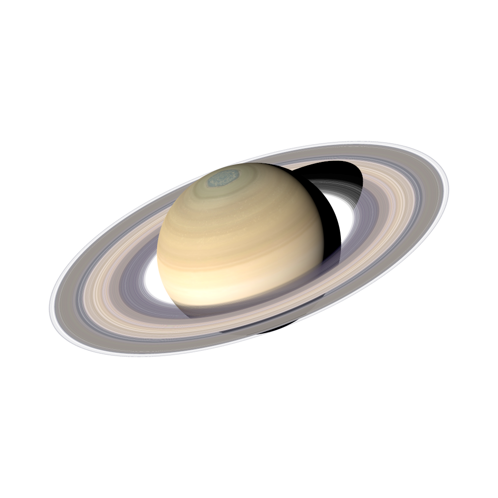
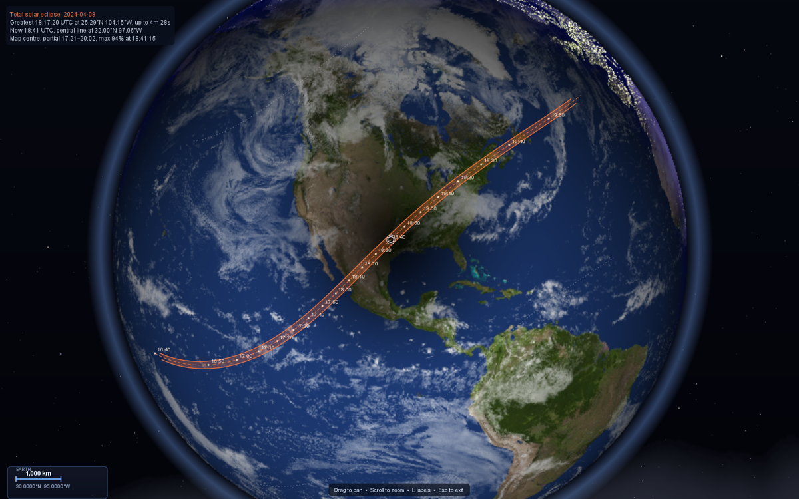

# Orrerium



An interactive Java solar-system simulator with a built-in **Lesson Studio** of
hands-on, animated 3-D astronomy lessons.


The app is a Swing program with a GPU sphere shader (`GLSphereRenderer`) for
textured planets. The planets, dwarf planets, comets and asteroids move under their
**mutual gravity**, integrated by a symplectic Wisdom–Holman map from JPL Horizons
initial conditions; every moon is on its real orbit; and the whole scene sits in front
of the **real star field** (Yale Bright Star Catalogue + Milky Way). The Moon follows the
full **ELP/MPP02** lunar theory, within 0.05″ of JPL's DE441. It hosts the
**Lesson Studio**, a real-date **planetarium**, a **Sky from Earth** view of the sky
from any place on Earth, and a catalog of real comets and minor bodies. The 3-D view
tilts off top-down to reveal orbital inclination and out-of-plane motion.

Real **spacecraft** fly inside the same scene: Voyager 1 and 2, Cassini, New Horizons and
Juno from JPL's trajectories, and the Moon missions from Apollo 8 to Artemis II played
back in 3-D with a mission timeline. There is a **Lambert transfer planner** with porkchop
plots, a **sky-events finder** (conjunctions, oppositions, elongations, transits,
occultations, meteor showers, eclipses), and a **light-time** view that shows where things
appear from Earth. **Solar eclipses** are drawn on the Earth Explorer globe: the path of
totality with its limits, the moving shadow, and the local circumstances anywhere. The paths
are within about 1 km of NASA's.

## Requirements

- **JDK 24** (the sim uses unnamed `_ ->` variables and other Java 22+ features).
- **JOGL 2.6** + **GlueGen 2.6** natives. These are **not** on Maven Central and
  are **not** committed here — download a build from the
  [JogAmp archive](https://jogamp.org/deployment/archive/master/). By default the
  build looks for them in the sibling folders the run script uses (one directory
  *above* the project root); override with `-PjoglDir=…` / `-PgluegenDir=…`.
- FlatLaf is fetched automatically (from Maven Central) by the Gradle build; a
  bundled copy is also in `libs/` for the PowerShell script.
- **Python 3 with numpy and astropy**, only for the coding lesson (Project 1): its code cells run
  on the computer's own Python (`py -3`, `python` or `python3`, or `-Dsss.python=<path>`).
  Install the packages with `python -m pip install numpy astropy`. Without them the rest of the
  app works and the cells say what is missing.

## Running

### Gradle (cross-platform, recommended)

The wrapper needs no local Gradle install and auto-provisions a matching JDK:

```bash
./gradlew run                 # build + run (GUI)
./gradlew run -Pgpu           # GPU sphere shader on from the start
./gradlew run -Pshot=out/dir  # render the head-less showcase PNGs, then exit
./gradlew run -Ppitch=30      # start with the view tilted 30 deg off top-down
./gradlew run -Pyaw=45        # start rotated 45 deg in azimuth
```

If the JOGL jars aren't in the default location, point the build at them:

```bash
./gradlew run -PjoglDir=/path/to/jogl/jar -PgluegenDir=/path/to/gluegen/jar
```

### PowerShell (Windows)

```powershell
./run2d.ps1              # build + run (GUI)
./run2d.ps1 -Gpu         # GPU sphere shader on from the start
./run2d.ps1 -Shot out\shots   # head-less showcase screenshots
```

### Settings and shortcuts

The app remembers its display toggles, the planets and objects shown, the UI size, the time
speed and the window's size and position in `~/.orrerium/settings.properties` (beside
the sky view's observer location and the AI key). They are saved when you quit; if you quit
during a lesson, the settings from before the lesson are saved. Delete the file to go back to
the defaults. `-Pgpu` / `-Dsss.gpu` overrides the saved GPU choice.

The menus show each toggle's single-key shortcut (O, R, L, …). The menu items also have
shortcuts of their own: **Ctrl+G** go to date, **Ctrl+T** jump to today, **Ctrl+E** next
events, **Ctrl+L** lessons, **Ctrl+Q** exit and **F1** the list of controls. **Alt** plus the
underlined letter opens a menu.

## Installing the app (macOS and Windows)

The packaged app is self-contained: it carries its own trimmed Java runtime, JOGL with its
natives, FlatLaf and the `assets/` folder, so nothing else needs installing (Python is still
only needed for the coding lesson's cells). Builds come from the **Packages** workflow on
GitHub: open a run (Actions → Packages, or a pull request's *Checks*) and download from
*Artifacts*: `orrerium-macos-ARM64` (Apple Silicon), `orrerium-macos-X64` (Intel Mac) or
`orrerium-windows-x64`. Or build them yourself (below).

### Windows

- **Installer:** run `Orrerium-<version>-setup.exe`. It installs for your user only (no
  administrator prompt), lets you pick the folder (default `%LOCALAPPDATA%\Programs\Orrerium`),
  and adds Start-menu and desktop shortcuts. A newer installer upgrades it in place; remove it
  from **Settings → Apps → Installed apps**.
- **Portable:** unzip `Orrerium-<version>-windows-x64.zip` anywhere and run
  `Orrerium\Orrerium.exe`.
- The builds aren't code-signed, so Microsoft Defender SmartScreen may say *"Windows protected
  your PC"* the first time: click **More info → Run anyway**.

### macOS

1. Download the `.dmg` for your Mac: `…-arm64.dmg` for Apple Silicon (M1 and later),
   `…-x86_64.dmg` for Intel.
2. Open the `.dmg` and drag **Orrerium** onto **Applications**.
3. The first launch of an unsigned build is blocked by Gatekeeper ("Apple could not verify
   'Orrerium' is free of malware…"). To allow it once:
   - **macOS 15 Sequoia and later:** click **Done**, open **System Settings → Privacy &
     Security**, scroll to *"Orrerium" was blocked…*, click **Open Anyway** and confirm.
   - **macOS 14 and earlier:** Control-click (right-click) the app in Applications, choose
     **Open**, then **Open** again.
   - Or, in Terminal, clear the download quarantine flag (this also fixes an *"is damaged and
     can't be opened"* message):

     ```bash
     xattr -dr com.apple.quarantine "/Applications/Orrerium.app"
     ```

   A build signed with a Developer ID and notarized (see below) opens without any of this.

Settings and lesson progress live in `~/.orrerium/` as on every platform, so they survive
reinstalling. (The app used to be called Astronomy Suite; its old `~/.astronomy-suite/` folder is
moved there on the first launch.)

### Building the packages

With JDK 22 or later (24 or 25 recommended; `JAVA_HOME` is used, or `/usr/libexec/java_home`
on a Mac), on a Mac or in Git Bash on Windows:

```bash
./package.sh
```

Everything lands in `build/package/dist/`: on a Mac `Orrerium.app` and
`Orrerium-<version>-<arch>.dmg`; on Windows the `Orrerium\` app folder,
`Orrerium-<version>-setup.exe` and `Orrerium-<version>-windows-x64.zip`. The Windows installer
needs the [WiX Toolset](https://wixtoolset.org) (v3.14, or v4/v5 with JDK 24+) on the `PATH`.

The script compiles `src/`, downloads the JOGL 2.6 / GlueGen jars and this platform's natives
from jogamp.org into `build/jogamp/` (SHA-256 checked; or point `JOGL_DIR` / `GLUEGEN_DIR` at
your own), jlinks a runtime, builds the app with `jpackage` (icon: `assets/icon/orrerium.png`,
turned into an `.icns` or `.ico`), launches it once in self-test mode from another folder (as
Finder or a shortcut does) to check that the assets and natives load, then builds the
installers. `APP_VERSION=1.2.0 ./package.sh` sets the version, and `./package.sh --app-image`
stops after the app (that also works on Linux).

A package's runtime matches the JDK's OS and architecture, so each is built on its own
platform. The GitHub workflow (`.github/workflows/package.yml`) builds all three (Apple Silicon,
Intel Mac, Windows x64) on a manual run, on `v*` tags (the tag sets the version), and on pull
requests that touch the packaging.

### Signing and notarization (optional)

Without these the app gets an ad-hoc signature and Gatekeeper's first-launch prompt above.
With an Apple Developer ID, set:

| Variable | Effect |
|---|---|
| `MAC_SIGN_IDENTITY` | e.g. `Developer ID Application: Jane Doe (TEAMID)`: signs the app (hardened runtime, `packaging/macos/entitlements.plist`) and the `.dmg` |
| `MAC_KEYCHAIN` | keychain holding that identity, if not in the default search list |
| `NOTARY_PROFILE` | a `xcrun notarytool store-credentials` profile: notarizes and staples the `.dmg` |
| `APPLE_ID`, `APPLE_TEAM_ID`, `APPLE_APP_PASSWORD` | notarize with an app-specific password instead of a profile |

In CI, add the repository secrets `MACOS_CERTIFICATE` (base64 of the `.p12`),
`MACOS_CERTIFICATE_PASSWORD`, `MACOS_SIGN_IDENTITY` and, for notarization, `APPLE_ID`,
`APPLE_TEAM_ID` and `APPLE_APP_PASSWORD`; the workflow imports the certificate into a temporary
keychain and passes them on.

### Where the app finds its assets

Assets are looked up in this order (`src/Assets.java`): the `-Dsss.assets=<dir>` property (the
packaged app sets it to the folder inside its bundle), then `./assets` in the working directory
(Gradle and `run2d.ps1` runs), then an `assets/` folder beside or above the compiled classes or
jar. So the app works whatever folder it is started from. `-Dsss.selftest` prints where the
assets were found and checks that they and the JOGL natives load.

## Lesson Studio

Open **Education → Lessons...** (or pick a lesson directly from the Education menu).

The lessons come in **course bundles**: pick **AST101** (*Exploring the Solar System*) or **AST221**
(*Astrophysics I*) at the top of the lesson list, or from the course submenus of the Education menu. A
bundle has its own lessons in its own order, and keeps only the steps that match that course's slides.
AST101 uses ten of the lessons, without the steps that need RA/Dec, magnitudes, solid angle or
integrals; `docs/LESSON_PLAN_AST101.md` maps it to the AST101 slides and lists the topics still without
a lesson. The app remembers the last course you picked.
Lessons run on the live simulation. A lesson panel docks on the right, and each
step reconfigures the real solar system to demonstrate its idea: it shows only the
bodies it needs, sets the clock (and sometimes the date), flies the camera there,
and draws its explanations straight into the 3-D scene or the sky. The eccentricity lesson
follows the real Mercury through perihelion and aphelion; the flux lesson hides
every planet and wraps the real Sun in a Gaussian bubble, then flies in close to
its textured surface. You keep the normal camera controls (drag, scroll;
double-click returns to the step's view). The panel holds the narration, sliders
and "check yourself" questions. **Esc** or **← Lessons** restores the simulation
exactly as you left it: visibility, date, time speed and camera.

The AST221 bundle's twelve lessons follow the first half of a first astrophysics course (UTM's AST221,
Days 2–8, plus its first Python project and a rehearsal of its Titan final project); `docs/LESSON_PLAN.md` maps each
course topic to a lesson and rates how well it fits a solar-system simulation. Steps that go beyond those slides are hidden by default (marked † below): the seasons
check, planet temperatures and habitable zones, planets' changing brightness, and aliasing.
Start with `-Dsss.lessons.all=true` to show them too.

| # | Level | Lesson | What you do |
| - | ----- | ------ | ----------- |
| 1 | Beginner | **Reading the Sky** | On the real sky over the UTM campus (Sept 21, 2026): altitude and azimuth, the celestial pole at your latitude (try other places), RA / Dec, sidereal time and hour angle, and planning an observation of the real Saturn near opposition (rise, transit, set, 90° − \|φ − δ\|). |
| 2 | Beginner | **How Big Does It Look?** | The 2024 total eclipse over Niagara Falls (Sun and Moon both ~0.53°), the thin wedge θ = D/d makes at the Moon, the Sun's solid angle from every planet, and Jupiter's 47″ disc through a tracking telescope. |
| 3 | Intermediate | **Telescope Power** | Open the aperture and watch Neptune and then Triton appear (m = 5 + 5 log D/7 mm); see the image a telescope really delivers of the real Pluto–Charon pair (Airy pattern, seeing in Mississauga or on Mauna Kea, adaptive optics), and thin or thicken the air with a density slider (seeing ∝ ρ^6/5, the Fried length and Strehl ratio, light lost to extinction); build an Earth-sized interferometer. |
| 4 | Beginner | **Orbits That Stretch** | Watch the real inner planets, stretch a what-if orbit beside Earth's (both foci, d₁ + d₂ = 2a), follow the real Mercury through perihelion q = a(1−e) and aphelion Q = a(1+e) with equal-time wedges (Kepler's 2nd law), then fly to Venus, Earth, Mars, Pluto and Halley's Comet (plus a seasons check†). |
| 5 | Intermediate | **Weighing the Solar System** | P² = a³ on the eight planets with their measured periods, weigh the Sun from Earth's year, Jupiter from the traced orbits of its four moons (1.90 × 10²⁷ kg), and Pluto + Charon from their real dance about a barycentre outside Pluto. |
| 6 | Intermediate | **Luminosity, Flux & Intensity** | With every planet hidden, wrap the real Sun in a Gaussian bubble and count light packets crossing it (always L, for any size or shape), watch one bundle of light spread over 1, 4, 9 tiles (inverse-square law), build 4πr² as a Riemann sum of r² sinθ Δθ Δφ patches, see why a star's surface brightness (intensity) doesn't change with distance, and integrate F = ∫ I cosθ dΩ = πI (R/d)². |
| 7 | Intermediate | **Hot Bodies Glow** | Planck curves and Wien's law for the Sun, a what-if star beside it (Stefan–Boltzmann), each planet's equilibrium temperature from its live distance against the measured one†, Mars between perihelion and aphelion†, and the Earth-like zone around an M dwarf†. |
| 8 | Intermediate | **Project 1: Blackbody Radiation** | A coding lesson: the AST221 Python project rewritten around the Sun, with fill-in-the-blank Python cells that run inside the sim and draw their results into the scene. Time sunlight's trip from the live Earth–Sun distance, code Planck's law for the Sun (the checks catch the notebook's misplaced-parenthesis bug), see why sunspots look dark, find the Sun's peak with argmax and Wien's law, loop Wien's law over the planets, compare Bλ with Bν, and compute the sunlight reaching Earth and every planet today. |
| 9 | Intermediate | **How Bright?** | Magnitudes on the real winter sky (with light pollution), Vega as the zero point, Mars brightening toward its Feb 2027 opposition†, absolute magnitude, B − V colour, the naked-eye stars filtered by spectral class, and the Bohr atom's Balmer lines. |
| 10 | Intermediate | **Measuring Distance** | Earth's real orbit as the baseline: the true-scale parallactic ellipses of α Centauri, Barnard's Star, 61 Cygni, Sirius and Vega, the parsec, three years of proper motion plus parallax, and how far Hipparcos and Gaia reach. |
| 11 | Advanced | **The Sun Wobbles Too** | The Sun's real path about the barycentre from the N-body integration, seen astrometrically from 10 pc; its radial-velocity curve at any inclination and Jupiter's minimum mass from it; real transits of Jupiter and Earth with their light curves; binary-star mass checks. |
| 12 | Intermediate | **Titan Lab** | Through a 100 mm telescope tracking Saturn from Mississauga, log Titan's real offset night by night (with optional clouds), fit its period by least squares (and see aliasing†), and weigh Saturn. The telescope keeps north up, as on an equatorial mount, so the field does not rotate. |

The scenes are computed, not canned: orbits come from Kepler's equation and vis-viva,
the photon counters count real crossings, and both integrals are live Riemann sums shown
next to their closed forms. Every position, magnitude and velocity the newer lessons
show is read from the running simulation (the N-body planets, the moons' theories, the
Sun's barycentric offset, the planetarium's apparent sky), never from a table of answers.
Annotations are projected through the simulation's own camera by a small depth-sorted
renderer (`R3` in `LessonStudio.java`), and anything behind the Sun's disc is hidden by it.
Sky steps run in the **Sky from Earth** view: their annotations are east-north-up
directions projected the way the planetarium projects the sky, and a telescope step's
view tracks its target like a clock drive. Shared helpers for the lessons in their own
files (`*Lesson.java`) are in `LessonKit.java`.

Developer flags: `-Dsss.course=AST101` picks the course bundle (default AST221) for the flags below; `-Dsss.lesson=N` starts lesson N of it at start-up (0 = just open the lesson list);
`-Dsss.lessonshot=<dir>` renders every step of every lesson to PNGs head-less and exits
(add `-Dsss.lessonshot.only=3,5` for just those lessons, and `-Dsss.lessonshot.solve=true` to fill and run each code cell first);
`-Dsss.missionshot=<dir>[,id…]` renders every timeline event of the missions (e.g.
`out/m,apollo11`) head-less and exits.

## AI Assistant

Open **Help → Ask AI Assistant...** for a built-in chatbot specialized in this app.
It is primed with a reference of the app's features and controls, and — importantly —
a **live snapshot of the running simulation** is sent with every question, so it can
answer things like *"what planet is selected?"*, *"what date is it in the sim?"*,
*"how fast is time running?"*, or *"how do I follow a moon?"* accurately. It keeps
conversation context for follow-ups, will happily answer general questions too, and
**Clear** starts a fresh chat.

The live state passed to the assistant includes the simulated date/time and elapsed
years, the time speed and pause state, the selected body and moon, what the camera is
following, the zoom mode, and toggles like orbits/labels/barycentric frame.

It also sees:

- **The lesson you are on:** the lesson and step, the narration on screen, the readouts and
  formulas shown, and every slider and choice setting. On a check-yourself question it knows
  the answer, but it is told to tutor with hints first and only give the answer if you ask
  for it outright.
- **The local sky:** from your observer location at the simulated time, whether or not the
  Sky from Earth view is open. That covers the Sun's altitude and the state of the sky, the
  Moon's phase and position, each planet's altitude, direction, brightness and whether it is
  visible, and the brightest stars up. When the sky view is open it also gets where you are
  looking and what is in the field.

So you can ask things like "what does this step mean?", "why did the flux go down?" or
"what is the bright thing low in the east?".

The assistant uses **Google Gemini's free tier**, which costs nothing — no billing
account is required — but does need a free API key. The first time you open the chat,
click **API key...**, then **Get a free key** (it opens
[aistudio.google.com/apikey](https://aistudio.google.com/apikey)), sign in with a
Google account, create a key, and paste it in. The key is saved locally in
`~/.orrerium/ai.properties` so you only enter it once, and it is only ever
sent to Google.

You can also supply the key and tweak the backend with JVM flags or environment
variables:

| Setting | JVM flag           | Env var                        | Default                 |
| ------- | ------------------ | ------------------------------ | ----------------------- |
| API key | `-Dsss.ai.key=`    | `GEMINI_API_KEY` / `SSS_AI_KEY`| _(entered in the UI)_   |
| Model   | `-Dsss.ai.model=`  | `SSS_AI_MODEL`                 | `gemini-3.6-flash`      |
| Base URL| `-Dsss.ai.base=`   | `SSS_AI_BASE`                  | Gemini REST base        |

## Dynamics: a symplectic N-body Solar System

Nothing moves on a fixed ellipse. `NBodyEphemeris` integrates the Sun, the
eight planets (the Earth–Moon barycentre and the planet-*system* barycentres, as
JPL's DE ephemerides carry them), Pluto–Charon, Ceres, Haumea and Eris under their
**mutual gravity**, with the catalogued comets and asteroids as test particles that
feel all of them. Initial conditions are the JPL Horizons heliocentric
ecliptic-J2000 state vectors at J2000.0.

- **Integrator** — a democratic-heliocentric **Wisdom–Holman** map (kick · jump ·
  exact Kepler drift · jump · kick, step ½ day). It is symplectic and
  time-reversible, so energy errors stay bounded (|ΔE/E| ≈ 2×10⁻⁹ over 1800–2200)
  and integrating backwards retraces the same states.
- **General relativity** — the Sun's 1PN term (harmonic coordinates, as in the DE
  ephemerides), which gives Mercury its 43″/century perihelion advance *and* the
  right mean motion. (The simpler Nobili–Roxburgh potential gets the advance but
  shifts the mean motion — it put Mercury ~100″ off Horizons by 2050.)
- **The Earth–Moon pair** — the Sun pulls the Earth and the Moon separately; that
  quadrupole tide changes the barycentre's mean motion by ~10⁻⁷, which without it
  puts Earth ~5000 km (8″) off after 50 years. It is applied exactly, using the
  lunar theory's Earth–Moon vector.
- **Planet centres** — each planet's centre sits off its system barycentre by its
  moons' reflex: Earth by up to ~4700 km, Pluto by ~2100 km — so Pluto and Charon
  visibly orbit a point in the space between them.
- **Symplectic corrector** — states are read out through the Wisdom–Holman–Toussaint
  corrector (pairs of conjugated kicks matched to the map's error series through h⁷), which
  removes the step error without touching the integration: Mercury went from 15″ to 0.02″
  by 2100, Earth from 0.6″ to 0.03″.
- **Minor bodies near the Earth** feel the Earth and the Moon as separate masses, not their
  barycentre. Bennu's 2005 and 2011 flybys amplified that difference to 1200 km by 2020;
  split, it is 180 km.
- **Yarkovsky** — Bennu carries the transverse thermal acceleration A2·(1 AU/r)², with
  A2 = −4.56×10⁻¹⁴ AU/day² set from its measured drift da/dt = −284.6 m/yr
  (Farnocchia et al. 2021).
- **Orbit rings** are the *osculating* ellipses of the bodies' current states — the
  orbit each body is on right now; they slowly turn and breathe as the planets
  perturb one another.
- **Any date** — states live on a ½-day grid with checkpoints; a date jump
  integrates from the nearest checkpoint (~0.25 s per 50 years the first time).
  Between grid points both neighbours are propagated along their two-body orbits and
  blended, so motion is smooth and identical at any time-warp.

`./gradlew test` checks it against Horizons at 1950, 2010, 2050 and 2100
(**`AccuracyTest`**): every planet within 0.03″ (Neptune 0.14″ by 2100), Earth's
centre included; Halley at its 1986 perihelion 0.6″ (outgassing isn't modelled), Ceres
0.14″, Eros 0.05″, Bennu 0.23″. **`IntegratorTest`** checks reversibility, that the
corrector inverts exactly, bounded energy, that a position depends only on the time (not
on how the clock got there), and continuity across grid steps.

## Planetarium: jump to a real date

**Simulation → Go to date…** scrubs the whole system to any calendar date
(e.g. `2027-03-14`), placing every body at its real position for that moment;
the HUD shows the current simulated date. `Jump to today` and `Reset to J2000
epoch` are there too. Dates are typed and shown in **your computer's time zone**
(the HUD shows UTC too); add `UTC`, an offset like `+09:00` or a zone like
`Asia/Tokyo` to enter a time elsewhere. `simTimeSec = 0` is the J2000.0 epoch.

**Time scales.** The sim clock is UTC, while the dynamics run on TT (`Astro.ttSeconds`):

- **Since 1972:** TT is exactly UTC + 32.184 s + the leap seconds.
- **Before 1972:** TT is UT + ΔT, from the NASA/Espenak–Meeus polynomials (they meet the
  leap-second table within 0.07 s).
- **After the table:** ΔT follows the polynomials' predicted rise, joined on without a jump.
  The polynomial alone now overshoots the true value by ~5 s, which would move the Moon,
  and an eclipse shadow, ~5 km.

Earth's rotation uses UTC as UT1, which is under 0.9 s off.

## Real Moon and eclipses

The Moon is **not** a two-body Kepler ellipse (that model gets eclipse dates wrong
by months, because it has no epoch phase and a frozen node). `MoonEphemeris` evaluates the
full **ELP/MPP02** lunar theory (Chapront & Francou 2003). It is the ELP-2000/82 theory with
the planetary perturbations recomputed and the constants fitted to lunar laser ranging:
35 901 periodic terms, read from `assets/moon/elpmpp02.bin.gz`. The positions come out on
the mean ecliptic and equinox of J2000 (Laskar's precession), the frame of the planets.

- **Speed.** The full theory is ~0.3 ms per evaluation. The sim evaluates it at Chebyshev
  nodes over 8-day segments and interpolates (within 0.3 m of direct evaluation).
- **The integrator's tide.** The N-body integrator's Earth–Moon tide is a 10⁻⁷ effect, so it
  uses the series cut at 0.1″ terms: 2″, 4 µs.

`./gradlew test` machine-checks this:

- **`MoonEphemerisTest`**:
  - **The authors' reference positions.** Reproduced to 0.1 mm, which checks the series
    file and the evaluation end to end.
  - **JPL Horizons (DE441).** Within **0.043″ (80 m)** at eleven epochs, 1950–2100. The
    Meeus truncation of ELP-2000/82 it replaces was 10–22″ off.
  - **The interpolation.** It is checked against direct evaluation.
- **`EclipseAccuracyTest`**: every solar eclipse of 2023–2024 is found on its true
  NASA-catalog date, within 45 min of greatest eclipse (typically 5–15 min, the offset
  between longitude conjunction and greatest eclipse), and known lunar eclipses likewise.

"Show eclipse" jumps the clock to the **next real eclipse** (new/full moon near a node), not
a staged one.

- **`MoonDataTest`** — every moon's tabulated semi-major axis and period are
  mutually consistent with the parent's mass under Kepler's third law (worst 0.7%);
  this caught bad data for Dione, Umbriel, Ariel and Charon.

## The other planets' moons

Phobos and Deimos, the four Galilean moons, Titan, Enceladus, Rhea, Mimas, Tethys,
Dione, Iapetus, the five major Uranian moons, Triton and Charon are all at their
**real positions on any date**. `SatelliteEphemeris` is a mean-element theory —
a precessing ellipse on each moon's local Laplace plane, plus periodic terms for the
resonances (the Io–Europa–Ganymede Laplace resonance, Mimas–Tethys,
Enceladus–Dione, Phobos' tidal decay …) and the short-period mutual perturbations —
**least-squares fitted to JPL Horizons vectors** over 1950–2050 (≈ 17 000 samples
per moon from JPL's satellite ephemerides, with a held-out window to catch aliasing).
The orbits are tilted as they really are: the Uranian moons circle in Uranus's
98°-tilted equator and Triton runs retrograde. Moons are drawn at their real sizes.

**`SatelliteAccuracyTest`** compares every moon with Horizons at four epochs:
worst 0.10° as seen from the planet (most ≲ 0.05°), distances within 0.2 %; it also
checks Pluto's ~2130 km reflex about the Pluto–Charon barycentre.

## Real orientation: rotation, texture & shadow checks

Position is only half the picture — the planets are also turned the *right way*.
Each planet's on-screen spin is anchored to its real **IAU / WGCCRE 2015**
orientation (pole `α₀/δ₀` and prime meridian `W = W₀ + Ẇ·d`), so the meridian
rendered facing the Sun is the one the Sun truly stands over on that date, and it
stays correct at any time-warp speed and under any camera rotation. Earth keeps
its civil-clock lock (local noon at longitude 0 at 12:00 UTC); the other seven
planets follow their IAU prime meridian.

`./gradlew test` machine-checks this alongside the position accuracy:

- **`RotationTest`** — Earth's sub-solar point tracks the civil clock to within
  the equation of time (< 6°); the IAU spin rate `Ẇ` agrees with NASA's
  independent sidereal periods for all eight planets (< 0.5%, retrograde sign and
  all); the orientation datum is a pure function of elapsed time (identical after
  200 000 tiny steps vs one jump — the "all speeds" guarantee); and the shader
  paints the intended geographic meridian at the sub-solar point for any obliquity
  and Sun direction.
- **`ShadowTest`** — the ray-traced eclipse shadow (`eclipseFactor`) casts a deep
  umbra on the Sun line, ignores bodies off-axis or behind the surface, has a
  monotonic penumbra, and is invariant under any 3-D camera rotation and any
  occluder distance along the Sun line (a true geometric shadow, never a
  screen-space band).
- **`HandednessTest`** — the 3-D view is a proper picture, not a mirror image. Seen from
  above the ecliptic the planets go round counter-clockwise, and the background sky shows
  the constellations the right way round. (Both were once mirrored by a sign in the
  projection, which also needed the textures and eclipse shadows to be flipped back.)
- **`MoonOrientationTest`** — the Moon's IAU orientation keeps its near side to the
  Earth within its librations (8.1° in longitude, 6.9° in latitude), and Tranquility Base
  faced the Earth during Apollo 11.

Every planet spins about its **IAU pole**, and the Moon's texture follows its IAU orientation
(librations included), so the near side faces the Earth and the Apollo landing sites sit on
the maria they landed in.

## Real comets and minor bodies

The sim ships with a catalog of real Solar-System objects, integrated from their
Horizons J2000 states as test particles of the N-body system (so Jupiter really
does deflect them) —
comets (1P/Halley, 2P/Encke, 55P/Tempel-Tuttle, 109P/Swift-Tuttle,
C/1995 O1 Hale-Bopp), asteroids and near-Earth objects (Vesta, Pallas, Juno,
Hygiea, Eros, Bennu), and distant objects (Chiron, Quaoar, Sedna). The
**Objects** menu toggles each category and the labels. Comets grow a diffuse
anti-sunward ion + dust tail as they near the Sun, drawn at true physical scale.

Pair this with **Simulation → Go to date…**: e.g. jump to `1986-02-09` to watch
1P/Halley round the Sun with its tail.

## Earth Explorer (zoom in like Google Earth)

Click **Earth** to follow it, then **scroll in**: once Earth fills the frame the
view smoothly flies into the *Earth Explorer* — a Google-Earth-style globe you
can keep zooming into, all the way to **street level**.

- **Far out** it's a globe hanging in the solar system: the full-resolution local
  Earth map, orthographically ray-cast and lit by the Sun with a **date-accurate
  day/night terminator**, city lights on the night side, and drifting clouds. The
  terminator comes from the apparent Sun of the ephemeris (precession, nutation, sidereal
  time), so the equation of time and the true declination are in it.
- **From ~3000 km across**, the globe cross-fades into **streamed satellite
  imagery** (Esri World Imagery, Web-Mercator tiles) so you can dive down to
  buildings and streets — the globe view and the flat map are one continuous zoom.
- The satellite map keeps the **same day/night terminator** (the night side dims
  and takes a cool cast, tracking the real Sun) and carries **Google-Maps-style
  labels** — place names, country boundaries and roads/street names overlaid on
  the imagery.

- During a **solar eclipse** the Moon's shadow darkens the globe and the map, with the path
  of totality drawn over them (see [Solar eclipses on the globe](#solar-eclipses-on-the-globe)).

Controls: **drag** to pan, **scroll** to zoom, **arrow keys** to move,
**`+`/`-`** to zoom, **`L`** toggle map labels, **`S`/`C`/`I`** toggle
shading / clouds / night lights. **Scroll all the way back out** (or press
**`Esc`**) to fly back to the solar-system view, still following Earth.

Notes:
- The globe view is fully offline; drop in a higher-resolution
  `assets/textures/earth_diffuse.jpg` for a sharper globe.
- Street-level detail streams tiles over the internet from
  [Esri World Imagery](https://www.arcgis.com/home/item.html?id=10df2279f9684e4a9f6a7f08febac2a9)
  (© Esri, Maxar, Earthstar Geographics) and is cached on disk under the system
  temp dir. Without a connection the globe still works; deep zoom falls back to
  the last imagery it could load.

## Solar eclipses on the globe



**Simulation → Next solar eclipse on the globe** (or select a solar eclipse in **Next events**
and press **Path of the shadow on the globe**) jumps to greatest eclipse and opens the Earth
Explorer over it. Any solar eclipse within an hour of the sim time is drawn the same way while
you are in the explorer, so you can also scrub or run the clock through one.

- **The path** of totality or annularity: the band between its northern and southern limits,
  the central line with its time every 10 minutes (UTC), and the limits of the partial phase.
- **The shadow** is in the lighting. Each point gets the fraction of the Sun's light the
  Moon leaves it, with the Sun limb-darkened (I(μ) = 1 − 0.6(1 − μ)), so the penumbra deepens
  toward the umbra, and the umbra's footprint is outlined.
- **Local circumstances** at the map centre: the partial phase, the time and obscuration of
  maximum, and how long totality or annularity lasts there.

`SolarEclipse` works from what an observer sees, not from Besselian elements. At each
instant the apparent Sun (aberrated) and the light-time-corrected Moon are put in the
Earth-fixed frame (precession, nutation, sidereal time). From a point on the WGS-84
ellipsoid, the Sun's and Moon's angular radii and the separation of their centres decide
whether it sees a partial, total or annular eclipse. The central line is where the Sun–Moon
line meets the ellipsoid. A limit is where the shadow's edge reaches a place and then
recedes: a point on the footprint's outline where the margin stops growing (∂g/∂t = 0).
The Moon's radius follows NASA's convention (k = 0.2722810 for the umbra, 0.2725076 for the
penumbra), and the Sun's is 959.63″ at 1 AU.

**`EclipsePathTest`** checks the 2017-08-21 and 2024-04-08 eclipses against NASA's path tables:

- **Durations.** Totality on the central line is within 1 s (3 s at sunrise).
- **Greatest eclipse.** Within 36 s and 24 km, and γ within 0.002.
- **The path on the ground.** Within 0.3 km in 2017 and 1.3 km in 2024.
- **Timing.** Within 1–3 km of NASA's shadow at a given UT, and greatest eclipse within 4 s.

What is left is mostly NASA's, not ours. Their tables assume ΔT = 68.4 s (2017) and 70.6 s
(2024), while the true TT − UTC was 69.184 s, about 1 km along the track. The 2017 tables
come from JPL DE405, which agrees to 0.3 km. The 2024 ones come from the older
VSOP87/ELP2000-85, which agrees to about 1 km. With the Meeus-truncated Moon used before,
the path was 25 km and 45 s off.

The explorer's day/night terminator now uses the same apparent Sun. It used to follow a
sine-law declination with no equation of time, which put it up to 4° off.

## The real star field

The 3-D view's background is the real sky: the **Yale Bright Star Catalogue**
(BSC5, 9096 stars — every naked-eye star) at its true direction, magnitude, colour
(from B−V) and proper motion, with a Milky Way brightness map, all fixed at
infinity so they turn with the camera but never parallax. **View → Constellation
lines** adds the IAU figures.

## Sky from Earth


Press **`K`** (or **View → Sky from Earth…**) to stand on Earth and look up — at the
sim's date and time, from any place (**`L`** or **View → Observer location…**, with
presets from Greenwich to Mauna Kea; inside the Earth Explorer, **`V`** looks up from
the point under the map centre). It is a full planetarium driven by the same
ephemerides as the 3-D view, with the reductions an observatory would use:
light-time, annual aberration, topocentric parallax (up to a degree for the Moon —
what makes eclipses local), precession and nutation to the true equator of date,
Greenwich apparent sidereal time, and atmospheric refraction.

- **Stars, constellations and the Milky Way**, dimmed by extinction toward the
  horizon; the faintest visible star tracks the sky brightness.
- **The Sun, Moon and planets as real spheres** at their true angular size and
  orientation (IAU poles and prime meridians, textured): phases come out of the
  geometry, the Moon shows its real libration and earthshine, Saturn's rings tilt
  with the season, and the planets' moons (and comets and asteroids) appear where
  they are — zoom to a few arcminutes to see Jupiter's moons line up.
- **A physical sky**: blue by day, then civil, nautical and astronomical twilight
  coloured toward the Sun's azimuth, then night. During a **solar eclipse** the sky
  darkens with the visible fraction of the Sun, the brighter stars come out and the
  corona appears — e.g. Dallas, 2024-04-08 18:41 UTC, is total.
- **Click any object** for its magnitude, altitude/azimuth, RA/Dec of date,
  distance, apparent size, illuminated fraction and **rise / transit / set** times.

Each place carries its own time zone, so the HUD and rise/set times show the
observer's local clock alongside UTC. **`SkyViewAccuracyTest`** checks the whole chain
against astropy (ERFA/SOFA) at five sites and three dates from 1995 to 2040: stars
agree within 0.003°, the Sun, Moon and planets within 0.01°.

Controls: **drag** or arrows to look, **wheel** / `+` `-` to zoom (200° down to a
few arcminutes), `C` lines, `N` names, `G` alt-az grid, `Q` equatorial grid,
`E` ecliptic, `F` ground, `A` atmosphere, `T` now, **`Esc`/`K`** back to space.

## Spacecraft missions

**Missions → Moon missions / Deep space** plays a real mission inside the solar-system view.
The clock jumps to the launch, the camera follows the spacecraft, and a **mission panel**
docks on the right of the canvas. It shows mission elapsed time, the current phase,
distances and speeds, and a **timeline**; click any event to jump there, or use ◀ / ▶.
The panel's buttons set the **pace** (×¼ to ×8), the **camera** (auto framing, free, or off
after you click a planet), and for lunar flights the trail's **frame**:

- *Rotating*: the Earth–Moon rotating frame of the classic figure-eight free-return
  diagrams. Each past point is turned and scaled with the Moon's motion since then, so the
  trail stays attached to the Moon as it is now.
- *Inertial*: the path as it really ran relative to the stars.

**Auto pace** sets the clock so the followed craft crosses the view in about twelve seconds,
from its speed relative to the nearest body. It slows right down for a landing and races
through a three-day coast. **Auto camera** frames each phase, and the timeline's events
carry close-up hints for undocking, landing and rendezvous. Click a craft's marker to follow
it (the lunar module, say). With **Missions → Show spacecraft in flight**, every probe whose
mission spans the current date is marked even when no mission is playing.

| Mission | Craft | Source of the trajectory |
| ------- | ----- | ------------------------ |
| Apollo 8, 11, 13, 17 | CSM (and LM for 11 and 17) | reconstructed (below) |
| Chandrayaan-3 | Vikram | JPL Horizons −158 |
| Artemis I | Orion | JPL Horizons −1023 |
| Artemis II | Orion *Integrity* | JPL Horizons −1024 |
| Voyager 1, Voyager 2 | | JPL Horizons −31, −32 (to 2030) |
| Cassini | | JPL Horizons −82 |
| New Horizons | | JPL Horizons −98 (to 2030) |
| Juno | | JPL Horizons −61 (to 2025-09-30) |

A mission whose track files aren't in `assets/missions/` is left out of the menus. That is the
case for **Apollo 11 and 17** for now: rebuilding them with the current code misses the
reconstruction's own targets (the LM rendezvous fails, and the return enters at 343 km / −12°
instead of 121.9 km / −6.5°), so they stay hidden until that is fixed and their tracks are
rebuilt.

**Playback.** Tracks are stored as segments of ecliptic-J2000 states relative to a centre
body. The base segment is relative to the Sun (or the Earth for lunar flights), and local
segments are relative to the planet or the Moon being visited. A craft is drawn at the sim's
*own* position of that centre plus the interpolated offset, so a flyby hugs the rendered
planet and a lunar orbit hugs the rendered Moon. `tools.FetchMissions` downloads each track
from Horizons. It samples finer near close approaches, where the dynamical time √(r³/GM) is
short, then keeps only the samples cubic Hermite interpolation needs to reproduce every
dropped one within max(0.2 km, 10⁻⁵ r). That is exactly how the sim interpolates. Flybys
and other events in the timeline are **measured from the track itself**, with
golden-section searches on the interpolant.

**Apollo, reconstructed.** JPL has no ephemerides for the Apollo command modules, so
`ApolloReconstruction` flies them again. It integrates the craft through the sim's own
Earth (+ J2), Moon (the lunar theory) and Sun with an adaptive Dormand–Prince 5(4), and targets
the events NASA documented (Orloff, *Apollo by the Numbers*, NASA SP-2000-4029):

1. **Translunar coast.** The state at pericynthion (documented time and altitude) is solved
   for, integrating *backwards* until it matches the documented TLI altitude, inertial
   speed, flight-path angle and orbital inclination. Levenberg–Marquardt runs first on a
   smooth conic version of the residual, then on the exact one. For a landing mission, the
   arrival plane must pass over the landing site at the landing instant. All Apollo lunar
   orbits are retrograde.
2. **Lunar orbit.** Each documented burn (LOI, circularisation, descent-orbit insertion) is
   an impulse that sets the documented apolune × perilune. One burn is trimmed by a few km so
   the LM arrives over the powered-descent point on time: −3.9 km for Apollo 11 and −9.8 km
   for Apollo 17, starting from a natural phase error of ~14°.
3. **Landing and ascent** follow polynomial-in-time guidance profiles (the form of Apollo's
   P63/P12 guidance) between the real orbital states and the real site. The site is placed
   on the Moon with its **IAU orientation model**, librations included. **Rendezvous** is a
   two-impulse Lambert transfer from the documented TPI time, corrected for the
   perturbations the two-body solution ignores.
4. **Transearth injection** is the impulse, timed within a revolution of the documented burn
   for least Δv, that reaches the entry interface (121.9 km) at the documented instant with
   Apollo's −6.5° entry angle. For Apollo 13, the burn is the PC+2 burn at its documented
   time.

Independent checks that come out of the physics rather than being put in:
- Apollo 13's computed Earth occultation behind the Moon, 077:08:22–077:33:24 GET, against
  the documented 077:08:35–077:33:10.
- Apollo 13's solved PC+2 burn, 252 m/s, against the 262 m/s (860.5 ft/s) flown.
- The landing-phasing trims, a few km for a ~14° natural phase error.

Rebuild the data with `java tools.FetchMissions [id…]` (needs network) and
`java ApolloReconstruction [id…]`, run from the project root on the compiled classes.

## Transfer planner

**Missions → Transfer planner** docks a planner beside the view. Pick two bodies and a
departure date (or **Sim date**), and a time of flight (or **Hohmann**).

- **Solve transfer.** Takes both planets from the sim's N-body ephemeris (the departure
  planet at departure, the target at arrival) and solves **Lambert's problem** around the
  Sun (universal variables, bracketed Newton). It reports the hyperbolic excess speeds at
  both ends, the launch energy **C3 = v∞²**, and the **Δv** to leave a low circular parking
  orbit and to be captured into one: Δv = √(v∞² + 2μ/r) − √(μ/r).
- **The 3-D view.** The transfer arc is drawn in the scene (the solved conic, propagated
  exactly), with both planets where they will be. **Fly this transfer** runs the clock
  through it with a virtual craft riding the arc.
- **Porkchop plot.** Sweeps a grid of departure × arrival dates around the chosen date,
  coloured by C3 or total Δv, with C3 contours. Click any cell to load that transfer.

**`LambertTest`** checks the solver against Curtis' Example 5.2 and a Hohmann transfer, and
that every solution, propagated exactly, lands on its target. It also checks the real
**Perseverance** dates (launch 2020-07-30, arrival 2021-02-18). The planner gives
**C3 = 14.46 km²/s²**; the mission's launch C3 was ≈14.5. The 2020 window's minimum falls on
2020-07-20.

## Sky events

**Simulation → Next events** searches the sim's own ephemerides from the current date for:

- conjunctions (with the Sun, and between the naked-eye planets) and oppositions;
- greatest elongations of Mercury and Venus;
- **transits** of Mercury and Venus;
- **lunar occultations** of the planets and of Aldebaran, Regulus, Spica and Antares;
- **meteor-shower peaks**;
- eclipses.

Clicking an event jumps the clock there; **See it from Earth** opens the Sky-from-Earth view
on it. For a solar eclipse, **Path of the shadow on the globe** opens it in the Earth Explorer
(see [Solar eclipses on the globe](#solar-eclipses-on-the-globe)).

Geocentric positions are light-time corrected. A transit is an inferior conjunction whose
minimum separation is smaller than the two discs' radii summed. An occultation is a
conjunction closer than the Moon's semi-diameter plus its horizontal parallax, so the Moon
covers the object from somewhere on Earth. A shower peaks when the Earth reaches the point of
its orbit closest to the parent comet's current integrated orbit: 109P/Swift-Tuttle for the
Perseids, 55P/Tempel-Tuttle for the Leonids, and 1P/Halley for the η Aquariids and Orionids.

**`EventFinderTest`** checks against published almanac dates:

- Mars oppositions 2003–2027, Jupiter and Saturn oppositions, and Venus' inferior
  conjunctions and greatest elongations 2023–2025: all on the right UTC date.
- Mercury's six greatest elongations of 2024, with the right side of the Sun and angle.
- The 2020 Jupiter–Saturn great conjunction at 18:20 UT, 0.10° apart.
- Every transit of Mercury (2003, 2006, 2016, 2019) and Venus (2004, 2012), with greatest
  transit **within a minute** of the published instant, and none in 2020–mid 2032.
- The Moon's occultations of Mars (2022-12-08) and Venus (2023-11-09).
- The 2025 Perseids and Leonids within a day of their IMO solar longitudes.

## Light-time: true or apparent positions

**View → Apparent positions** (or **`T`**) draws every body where it *appears* from Earth: where it
was when the light now arriving left it. Jupiter is drawn 35–52 minutes back along its orbit,
with its moons and its rotation as they were then. A hollow ring with a dashed line marks
where each body really is now, labels show the delay ("seen 43.2 min ago"), and the info
panel gives the light-time to Earth. The retarded position comes from a second-order step
under the Sun's gravity, iterated to convergence; the error is under a kilometre even at
Pluto's 5½ hours.

## Saturn's rings

The rings lie in Saturn's **real equator plane** (its IAU pole), so they open and close on
the right dates. **`SaturnRingTest`** finds the Sun crossing the ring plane (Saturn's
equinox) on 2009-08-11 and 2025-05-06, and the Earth crossing on 2009-09-04 and 2025-03-23,
all within half a day.

Their brightness is a physical slab model: single-scattering particles in a layer of optical
depth τ (from the ring map's opacity), lit at μ₀ = sin(Sun elevation) and seen at μ:

- The **lit face** reflects ∝ μ₀/(μ₀+μ)·(1 − e^(−τ(1/μ₀+1/μ))), so the rings go **dark
  as the Sun reaches the ring plane**.
- The **unlit face** glows only by light diffusing through it: ∝ μ₀/(μ₀−μ)·(e^(−τ/μ₀) −
  e^(−τ/μ)).
- The rings' opacity grows as they turn edge-on, 1 − e^(−τ/μ).
- The **ring shadow on the planet** is sunlight transmitted through the slab, e^(−τ/μ₀).
- The **planet's shadow on the rings** is ray-traced.

## Data sources

- Planet, dwarf-planet, comet, asteroid and satellite states: **JPL Horizons**
  (Solar System Dynamics Group, JPL/Caltech).
- Stars: **Yale Bright Star Catalogue, 5th revised ed.** (Hoffleit & Warren 1991),
  CDS catalogue V/50 — `assets/sky/bsc5.csv`.
- Constellation lines, label positions and the Milky Way outline:
  [d3-celestial](https://github.com/ofrohn/d3-celestial) © 2015 Olaf Frohn,
  BSD-3-Clause (`assets/sky/LICENSE-d3-celestial.txt`); the Milky Way contours are
  rasterised into `assets/sky/milkyway.png`.
- Lunar theory: ELP/MPP02 (J. Chapront & G. Francou 2003, IMCCE / Observatoire de Paris),
  the series as packed by T. Jang's MIT-licensed port (`tools.FetchElpMpp02`);
  rotation models (planets and the Moon): IAU WGCCRE.
- Solar-eclipse paths for the tests: NASA's path tables by F. Espenak
  (eclipse.gsfc.nasa.gov), 2017-08-21 and 2024-04-08.
- Bennu's Yarkovsky drift: D. Farnocchia et al., *Icarus* 369, 114594 (2021).
- Spacecraft trajectories: **JPL Horizons** (Voyager 1/2, Cassini, New Horizons, Juno,
  Chandrayaan-3, Artemis I and II). Apollo flight data: R. W. Orloff, *Apollo by the
  Numbers*, NASA SP-2000-4029 (the scanned table reads Apollo 13's TLI speed as 35,938.4
  ft/s; the cutoff speed and every other flight's 10-second drop show it is 35,538.4).

## Repository layout

```
src/SolarSystemSimulation.java   the simulation canvas: dynamics hookup, camera, rendering
src/AppWindow.java               the window: menus, search bar, object tree, time controls, dock
src/AiAssistant.java             Help → Ask AI Assistant (Gemini chat with live sim context)
src/MissionPlayer.java           spacecraft playback: trails, markers, mission panel, auto camera
src/Missions.java                the mission catalogue and timelines
src/SpacecraftTrack.java         track files: segments, Hermite interpolation, thinning
src/ApolloReconstruction.java    Apollo 8/11/13/17 rebuilt by integration + targeting
src/Lambert.java                 Lambert's problem (universal variables)
src/TransferPlanner.java         transfer planner panel, porkchop plot, 3-D transfer arc
src/EventFinder.java             conjunctions, oppositions, elongations, transits, occultations…
src/SolarEclipse.java            solar eclipses on the ground: shadow, path, limits, local circumstances
src/EventsPanel.java             the "Next events" panel
src/NBodyEphemeris.java          symplectic N-body integrator (Wisdom–Holman, GR, Horizons ICs)
src/SatelliteEphemeris.java      planetary moons: theory fitted to JPL satellite ephemerides
src/MoonEphemeris.java           Earth's Moon: the full ELP/MPP02 lunar theory
src/Astro.java                   time scales (ΔT), precession, nutation, sidereal time
src/StarCatalog.java             Yale Bright Star Catalogue, constellations, Milky Way map
src/SkyView.java                 Sky from Earth: the planetarium view
src/LessonStudio.java            lessons: docked panel, 3-D stage, software 3-D renderer
src/PythonKernel.java            the Python process behind lesson code cells (harness, checks, JSON)
src/CodeCell.java                one fill-in-the-blank Python cell of a lesson step
src/GLSphereRenderer.java        GPU sphere shader for textured planets
src/tools/ScreenGrab.java        screenshot helper
src/tools/FetchMissions.java     downloads + compresses spacecraft tracks from JPL Horizons
src/tools/FetchElpMpp02.java     downloads + packs the ELP/MPP02 lunar series
assets/textures/                 planet / moon / sun texture maps
assets/sky/                      star catalogue, constellation data, Milky Way map
assets/moon/                     the ELP/MPP02 lunar series (35 901 terms)
assets/missions/                 spacecraft tracks (*.trk.gz)
src/Assets.java                  where assets/ is found, whatever the working directory
src/SaturnIcon.java              the app icon: Saturn ray-traced from its textures (-Dsss.icon=<png>)
assets/icon/orrerium.png         that render at 1024 px (the .icns and window icons are made from it)
libs/                            bundled FlatLaf look-and-feel
build.gradle / settings.gradle   Gradle build (./gradlew run)
run2d.ps1                        Windows build + launch script
package.sh                       app packaging: macOS .app + .dmg, Windows .exe + .zip (jlink + jpackage)
packaging/                       macOS signing entitlements; optional macos/Orrerium.icns, windows/Orrerium.ico overrides
.github/workflows/package.yml    CI: builds the .dmg files and the Windows installer + zip
```

## License

See [LICENSE](LICENSE).
